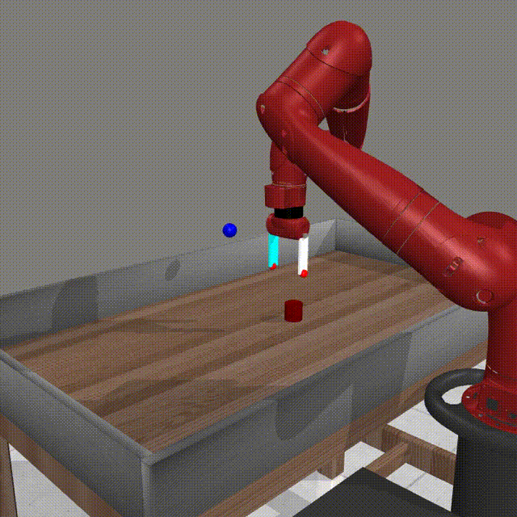
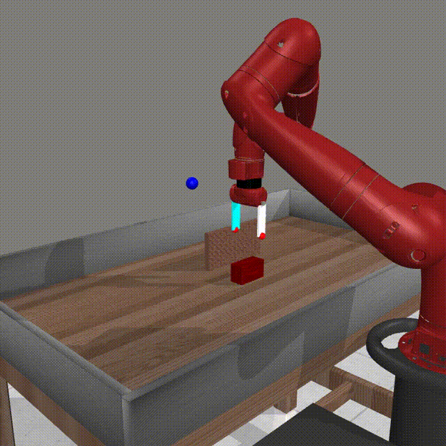
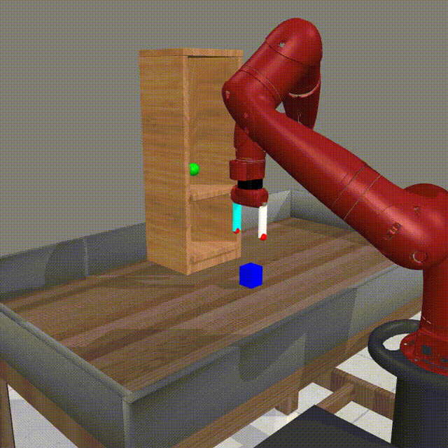
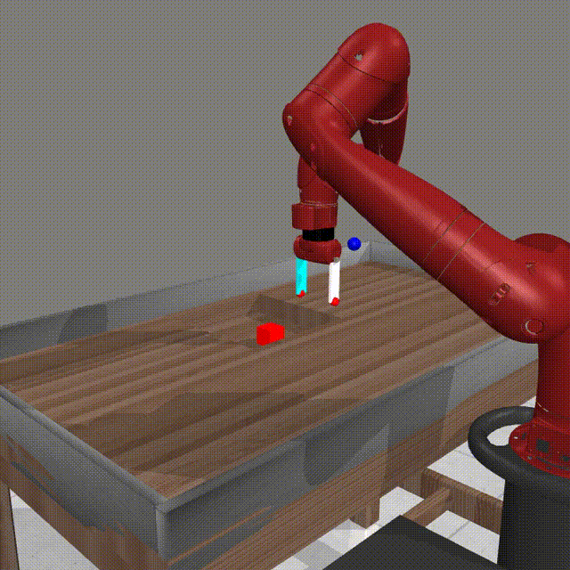

# Moebius

Moebius is a state-based reinforcement-learning project for MetaWorld robot
manipulation. It supports a single-task Soft Actor-Critic (SAC) baseline and a
Probabilistic Embeddings for Actor-Critic RL (PEARL) agent that adapts across
object shapes, environments, and optional hidden object dynamics.

## PEARL agent demonstrations

### PEARL agent on the pick-and-place task



### PEARL agent on the pick-and-place wall task



### PEARL agent on the pick-and-place shelf task



### PEARL agent on the pick-out-of-hole task



## Project phases

### Phase 1 — SAC baseline

Implements state-based Soft Actor-Critic with twin critics, entropy tuning,
replay, evaluation, TensorBoard logging, and checkpoints.

### Phase 2 — PEARL task inference

Adds a context encoder and latent-conditioned SAC policy. The encoder infers a
task latent from previous `(state, action, reward, next state)` transitions and
is evaluated on held-out tasks before and after adaptation.

### Phase 3 — Expert demonstrations and imitation learning

Moves the main manipulation environment to Meta-World `pick-place-v3`. Scripted expert
rollouts warm-start the policy through behavior cloning and remain available
during online training.

### Phase 4 — Object shapes and hidden properties

Adds cylinder, box, and bar objects with variable size. Tasks can also hide object
mass and friction, while feasibility checks reject objects the expert cannot
reliably manipulate.

### Phase 5 — Environments and grip force

Adds training across several related MetaWorld environments. Adds an optional
single-environment training that lets the agent choose post-contact squeeze force,
observe contact forces, and receive a penalty for unnecessary force.

## Project specifications

| Component | Tool or library | Purpose |
| --- | --- | --- |
| Language | Python 3.10+ | Training, evaluation, environment wrappers, and command-line tools |
| Learning framework | PyTorch 2.2+ | SAC and PEARL networks, optimization, and checkpoint state |
| Environments | MetaWorld with MuJoCo | State-based robot-manipulation tasks and physics simulation |
| Environment API | Gymnasium 0.29+ | Standard observation, action, reset, and step interfaces |
| Numerical computing | NumPy 1.24+ | Replay buffers, task sampling, observations, and metrics |
| Performance tracking | TensorBoard 2.14+ | Training losses, returns, success rates, and latent statistics |
| Testing | pytest 8.0+ | Unit and environment integration tests |

The project learns from state observations rather than camera images. By
default, training logs are written to `runs/`, checkpoints to `checkpoints/`,
and recorded episodes to `videos/`.

## Setup

Use Python 3.10 or newer and install the project in a virtual environment:

```bash
python -m venv .venv
source .venv/bin/activate
pip install --upgrade pip
pip install -e '.[dev]'
```

MetaWorld uses MuJoCo and may require platform-specific rendering libraries.
Run the test suite after installation:

```bash
pytest
```

## SAC training

### Object reaching with the original SAC protocol

This is the pure SAC baseline. It trains on `reach-v3` without demonstrations
or behavior cloning.

```bash
moebius-train --algorithm sac --env-name reach-v3 \
  --demo-episodes 0 --total-steps 1000000 \
  --eval-interval 10000 \
  --log-dir runs/sac_reach \
  --checkpoint-dir checkpoints/sac_reach
```

### Pick-and-place with demonstrations

This run collects successful scripted-expert demonstrations, behavior-clones
the actor before training, and keeps demonstrations in the online SAC updates
while the cloning weight decays.

```bash
moebius-train --algorithm sac --env-name pick-place-v3 \
  --demo-episodes 100 --bc-pretrain-updates 10000 \
  --demo-batch-fraction 0.25 --bc-weight 1.0 \
  --bc-decay-steps 250000 --total-steps 1000000 \
  --eval-interval 10000 \
  --log-dir runs/sac_pick_place \
  --checkpoint-dir checkpoints/sac_pick_place
```

## PEARL training

### Object shapes across multiple MetaWorld environments

This is the default shape-focused PEARL experiment. One agent trains across
four related manipulation environments and three object shapes. Mass and
friction remain at MetaWorld's nominal values, force control is disabled, and
each environment uses its dedicated scripted expert.

```bash
moebius-train --algorithm pearl --pearl-task-distribution dynamics \
  --pearl-env-names pick-place-v3 pick-place-wall-v3 shelf-place-v3 pick-out-of-hole-v3 \
  --object-shapes cylinder box bar \
  --num-train-tasks 20 --num-eval-tasks 10 \
  --latent-dim 5 --context-size 64 --meta-batch-size 8 \
  --pearl-demo-episodes-per-task 5 \
  --pearl-bc-pretrain-updates 5000 \
  --pearl-critic-pretrain-updates 5000 \
  --demo-batch-fraction 0.25 --bc-weight 1.0 \
  --bc-decay-steps 500000 --pearl-bc-weight-floor 0.1 \
  --context-sequences-per-task 4 \
  --pearl-reward-scale 0.1 --pearl-initial-alpha 0.02 \
  --pearl-decoder-weight 0 --max-episode-steps 300 \
  --pearl-eval-sequences-per-task 3 --eval-interval 30000 \
  --total-steps 1000000 \
  --log-dir runs/pearl_multi_shape \
  --checkpoint-dir checkpoints/pearl_multi_shape
```

The environment identity is not added directly to the observation. PEARL must
infer useful task information from transition context. Mass and friction
randomization remain disabled because `--pearl-vary-object-dynamics` is not
present.

### Object shapes with hidden mass, friction, and grip force

This experiment uses `pick-place-v3` because force control and contact-force
observations currently support that environment only. Every task varies object
shape, size, mass, and friction. Before contact, the environment closes the
fingers at a fixed speed; after contact, the fourth action selects squeeze
force. The reward penalizes force above the task's calibrated requirement.

```bash
moebius-train --algorithm pearl --pearl-task-distribution dynamics \
  --pearl-env-names pick-place-v3 \
  --object-shapes cylinder box bar \
  --pearl-vary-object-dynamics \
  --gripper-force-limit 60 --gripper-force-control \
  --contact-observations --pearl-grip-penalty 1.0 \
  --pearl-expert-variants careful slow_transport low_grasp metaworld \
  --num-train-tasks 20 --num-eval-tasks 10 \
  --latent-dim 5 --context-size 64 --meta-batch-size 8 \
  --pearl-demo-episodes-per-task 5 \
  --pearl-bc-pretrain-updates 5000 \
  --pearl-critic-pretrain-updates 5000 \
  --demo-batch-fraction 0.25 --bc-weight 1.0 \
  --bc-decay-steps 500000 --pearl-bc-weight-floor 0.1 \
  --context-sequences-per-task 4 \
  --pearl-reward-scale 0.1 --pearl-initial-alpha 0.02 \
  --pearl-decoder-weight 0 --max-episode-steps 300 \
  --pearl-eval-sequences-per-task 3 --eval-interval 30000 \
  --total-steps 1000000 \
  --log-dir runs/pearl_hidden_dynamics_force \
  --checkpoint-dir checkpoints/pearl_hidden_dynamics_force
```

During setup, candidates are assigned balanced gentle, medium, and strong grip
bands. The expert strategies are tried in the listed order, and a task is kept
only when one strategy succeeds reliably within its assigned band. Automatic
pre-contact closing is not penalized because that force was not selected by
the agent.

Training metrics can be viewed with:

```bash
tensorboard --logdir runs
```

For PEARL, the main adaptation signals are `eval/adaptation_gain`,
`stats/z_mean_task_std`, and the `eval/success_after_context_*` curves.

## Record trained policies

Record three deterministic SAC episodes:

```bash
moebius-record \
  --checkpoint checkpoints/sac_pick_place/pick-place-v3_sac_seed1.pt \
  --episodes 3
```

Record three PEARL context episodes followed by one adapted rollout on a
held-out task:

```bash
moebius-record \
  --checkpoint checkpoints/multi_shape_pearl/multi-pick-place_pearl_seed1.pt \
  --task-index 0 --adaptation-episodes 3 \
  --presentation-mode
```

Videos are saved under `videos/`. Use `--video-dir`, `--fps`, or
`--camera-name` to change the output directory, frame rate, or camera.
Presentation mode reduces visible finger/object penetration and ends shortly
after success. It slightly firms contact physics for the recording only, so
omit it when an exact evaluation rollout is required. Use
`--width 720 --height 720` for higher-resolution output, or
`--success-hold-steps` to tune the ending.

## Project challenges and limitations

- **Sawyer control is simplified.** MetaWorld exposes Cartesian hand motion
  and one gripper command rather than joint-level torque control. Grip force is
  approximated with MuJoCo actuator limits, so contact and force behavior should
  not be treated as a validated model of a physical Sawyer robot.
- **The task family may not require adaptation.** Similar resets and scripted
  grasp strategies can make mass, friction, or shape changes behaviorally
  irrelevant. Visible geometry can also reveal part of the environment before
  the encoder receives useful interaction evidence.
- **Latent collapse remains possible.** If the actor and critics solve every
  task without `z`, PEARL can map all contexts to nearly the same posterior.
  The implementation counters this with object-motion-focused context,
  complete adaptation sequences, one fixed latent per rollout, failed expert
  attempts, KL free bits, learnable `softplus` variance, and a posterior
  variance floor. Behavior cloning does not train the encoder, and an optional
  transition decoder can add task-inference pressure. These measures improve
  the learning signal but cannot create task differences that do not affect
  reward or optimal behavior.
- **Force experiments are narrow and expensive.** Force control currently
  supports only `pick-place-v3`. Expert feasibility checks and grip calibration
  add substantial setup time, and rejecting unsolved candidates biases the
  final task distribution toward objects the scripted experts can handle.
- **Simulation results do not establish real-world performance.** Policies use
  privileged state observations and have not been tested for visual perception,
  sensor noise, hardware delay, or simulation-to-real transfer.

## Relevant papers

- [PEARL: Efficient Off-Policy Meta-Reinforcement Learning via Probabilistic Context Variables](https://proceedings.mlr.press/v97/rakelly19a.html)
- [Soft Actor-Critic Algorithms and Applications](https://arxiv.org/abs/1812.05905)
- [Meta-World: A Benchmark and Evaluation for Multi-Task and Meta Reinforcement Learning](https://arxiv.org/abs/1910.10897)
- [Learning Complex Dexterous Manipulation with Deep Reinforcement Learning and Demonstrations](https://arxiv.org/abs/1709.10087)
- [VariBAD: A Very Good Method for Bayes-Adaptive Deep RL via Meta-Learning](https://arxiv.org/abs/1910.08348)
- [Layer Normalization](https://arxiv.org/abs/1607.06450)
- [Improving Variational Inference with Inverse Autoregressive Flow](https://arxiv.org/abs/1606.04934)
